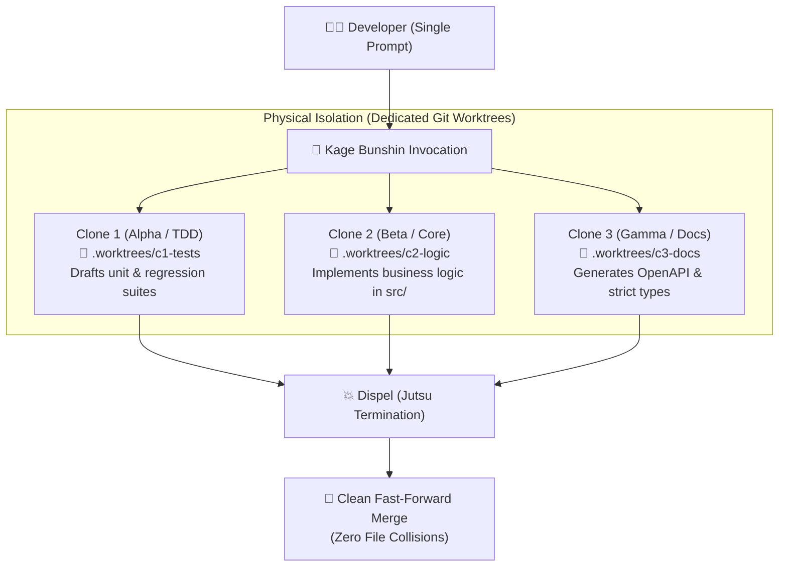
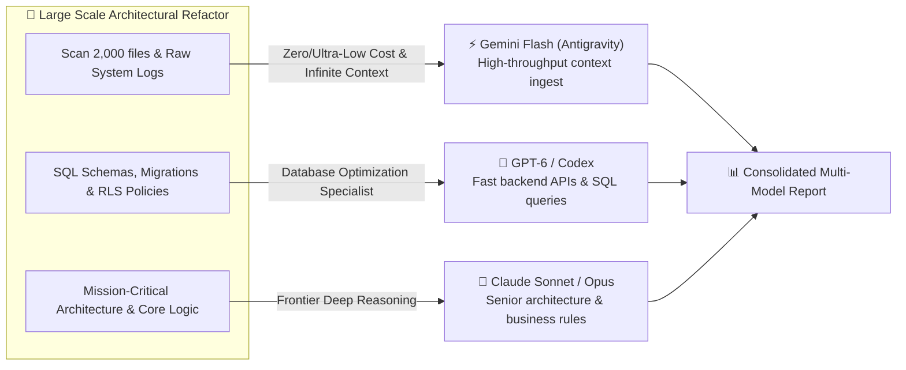
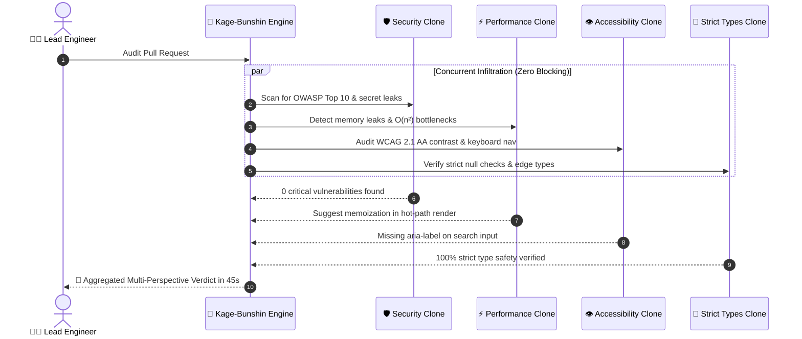
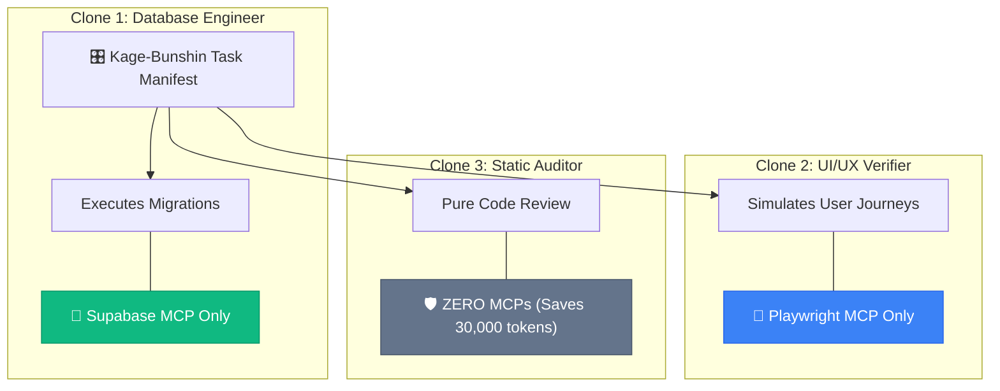

# 🥷⚡ Kage Bunshin (`kage-bunshin`)

[](https://skills.sh)
[](LICENSE)
[](#)
[](#)
[](#)
[](https://github.com/Gabrielrtads/kage-bunshin/actions)

[](https://github.com/Gabrielrtads/kage-bunshin/stargazers)

> ⭐ **If this jutsu saved you time or empowered your AI coding agents, please star this repository! It helps more developers discover the project.**

> **影分身の術 (Shadow Clone Technique) for AI Coding Agents.**  
> Spawn physical headless CLI clones of the **exact same agent** (e.g. $N$x Claude Code, $N$x Codex, or $N$x Antigravity) or orchestrate an extended Shinobi Alliance across isolated Git Worktrees — with automatic memory reintegration on dispel and zero zombie processes.

---

## ⚡ The Breakthrough: Self-Cloning vs. Sequential Single-Turn AI

Modern AI coding agents (Claude Code, OpenAI Codex, Antigravity) are designed as **single-turn, single-process tools**. When a complex feature demands:
- 🧪 **Test-Driven Development (TDD)** in `tests/`
- ⚙️ **Core Logic & Business Rules** in `src/`
- 🎨 **Frontend UI & Components** in `components/`
- 📚 **Documentation, Typings & OpenAPI Schemas** in `docs/`

Developers usually watch a single agent work sequentially, bottlenecking development and filling the context window with too many unrelated concerns.

**`kage-bunshin` brings the legendary Shadow Clone Jutsu to software engineering:**

```
                                  ┌──> Clone Alpha [Claude Code]: Unit & Regression Tests (Worktree A)
                                  ├──> Clone Beta  [Claude Code]: Core Business Logic (Worktree B)
[🥷 Developer / Hokage Agent] ────┼──> Clone Gamma [Claude Code]: UI & Tailwind Components (Worktree C)
   (Chakra & Watchdog Pool)       ├──> Clone Delta [Claude Code]: E2E & Integration Tests (Worktree D)
                                  └──> Clone Epsilon [Claude Code]: Schemas, Types & Docs (Worktree E)
                                                    │
                                                    ▼ (Dispel & Memory Reintegration)
                                       [Single Clean, Fully-Tested Feature]
```

---

## 🗺️ Architectural Diagrams & Mission Blueprints

### 1. 🥷 The Canonical Triad: Zero-Conflict Self-Cloning
When tackling a full feature, a single agent gets bogged down doing testing, implementation, and documentation sequentially. `kage-bunshin` spawns identical clones of the same CLI (e.g. 3x Claude Code) into isolated physical Git Worktrees, merging their work on dispel without git conflicts.



---

### 2. 🏯 The Shinobi Alliance: Cost-Smart Swarm Architecture
Why burn high-tier reasoning tokens reading thousands of lines of logs or basic schemas? Route each subtask to the optimal model based on capability and cost profile:



---

### 3. 🛡️ 4D Concurrent Code Audit: The Parallel Red Team
Instead of waiting 45 minutes for sequential audits (security, then performance, then accessibility, then typings), 4 shadow clones inspect the pull request simultaneously from different adversarial angles:



---

### 4. 🎯 Surgical MCP Scoping: Tool Chakra Partitioning
Loading 15+ MCP servers into a single agent wastes 30,000 tokens on schemas and causes catastrophic tool hallucinations. Kage-Bunshin isolates tools per clone so each shinobi only sees what it needs:



---

## 🌀 Two Execution Philosophies

### 1. 🥷 The True Kage Bunshin (Mono-Engine Self-Cloning: $N$ Clones)
The agent spawns **as many physical clones of itself as the task requires ($N$ clones)**, bounded only by hardware concurrency (`-MaxConcurrency`, default `8`, range `1-32`) and API rate limits. 
If you only have access to Claude Code (or Codex, or Gemini Flash), you don't need external orchestrators. The engine creates isolated CLI workers of the same model:

- **The Canonical Triad (Classic Example):**
  - **Clone 1 (Alpha):** Scaffolds tests, fixtures, and mocks.
  - **Clone 2 (Beta):** Writes implementation code until all tests pass.
  - **Clone 3 (Gamma):** Handles documentation, styling, and strict typing.
- **The Full-Stack Squad ($N = 5+$ Clones):**
  - Data model, backend endpoints, frontend UI, E2E tests, and OpenAPI documentation developed concurrently.

Each clone works in its own physical Git Worktree (`.worktrees/task-...`), preventing file write collisions, merge locks, or corrupted git trees.

### 2. 🏯 The Shinobi Alliance (Cost-Smart Frontier Hybrid Swarm)
Route tasks according to **capability vs. cost profile** to save 80%+ on AI token expenses using verified frontier models:

| Shinobi CLI | Frontier Models (2026) | Cost Tier | Best Suited Missions |
|---|---|---|---|
| **Antigravity (`agy`)** | Gemini 3.8 Flash / Gemini 4 Argon | 🟢 **Ultra-Low / Free Tier** | High-volume scanning, JSDoc generation, accessibility (WCAG) checks, test drafting. |
| **OpenAI Codex (`codex`)** | GPT-6 Luna / GPT-6.1 Sol / GPT-6 Astra | 🟡 **Cost-Effective** | Fast backend APIs, SQL optimization, data migrations, script automation. |
| **Claude Code (`claude`)** | Claude 4.5 Haiku / Sonnet 5.5 / Opus 5.5 | 🟣 **Elite Reasoning** | Mission-critical architecture reviews, adversarial security audits, complex refactoring. |

---

### 3. 🎯 Surgical MCP Scoping: Tool Chakra Partitioning

Why give all tools to all clones? A database clone doesn't need Playwright, and a security auditor doesn't need Supabase write permissions:

| The Problem: "All MCPs for Everyone" | 🎯 Kage Bunshin Surgical Scoping (`mcp_servers`) |
|---|---|
| **Inherited tools:** User/project configuration can add unrequested servers | **Claude:** Always uses `--strict-mcp-config`; nonempty lists load only selected definitions from `mcp_config`. |
| **Unsupported isolation:** A list alone does not restrict every CLI | **Fail closed:** agy is refused in both runners; Bash also refuses nonempty Codex lists. |

Declare `mcp_servers` per clone in your manifest:
```json
[
  { "id": "c1-db", "engine": "claude", "mcp_config": "mcps.json", "mcp_servers": ["supabase"], "prompt": "Review DB migrations" },
  { "id": "c2-ui", "engine": "claude", "mcp_config": "mcps.json", "mcp_servers": ["playwright"], "prompt": "Verify responsive UI layout" },
  { "id": "c3-audit", "engine": "claude", "mcp_servers": [], "prompt": "Pure code audit" }
]
```

`mcp_config` is a JSON file with a `mcpServers` object, resolved relative to the task's original working directory. Missing definitions fail before any clone or worktree starts. Only requested entries are forwarded; other user/project MCP configurations are ignored by Claude. `allow_mcp` takes precedence by presence, so `allow_mcp: []` explicitly disables MCPs even if `mcp_servers` is nonempty. Omitting both fields means an empty list.

Codex with an empty list uses `--ignore-user-config` (also discards other user settings). The existing PowerShell nonempty Codex path only filters names found in the user TOML; it is not a verified isolation boundary for other configuration sources. agy's installed help does not expose a verified session MCP allowlist, so both runners refuse agy instead of inheriting all servers. Use Claude for an enforced nonempty allowlist.

On Windows, `.cmd`/`.bat` CLI shims are refused because their shell parsing cannot safely carry arbitrary prompts. Install the native binary or a trusted `.ps1` launcher. The Bash runner honors `worktree: true` and `--worktree`, creates `task/swarmv2-<id>-<timestamp>` branches under `.worktrees/`, and aborts if isolation fails. It removes only unchanged worktrees and preserves work for review; it never merges results.

---

## 🍥 The Ninja Lore vs. Terminal Reality

| Naruto Lore (影分身) | Software Architecture Parallel | Terminal Reality |
|---|---|---|
| **Chakra Partitioning** | **Token & RAM Throttling** | Distributes system memory and API limits evenly. Prevents system crash (OOM). |
| **Specialized Jutsu Allocation** | **Surgical MCP Scoping** | Assign database tools only to backend clones, browser tools to UI clones, and 0 MCPs to auditors to eliminate tool confusion and save 30k+ tokens per clone. |
| **Physical Solid Clones** | **Isolated Git Worktrees** | Clones are not fake chat prompts; they are real headless CLI processes in dedicated directories. |
| **Arbitrary Clone Count ($N$)** | **Task Decomposition Scaling** | Spawn 2, 3, 5, 8+ clones as required by task granularity, managed by a concurrency pool. |
| **Memory Reintegration (Dispel)** | **Git Fast-Forward & Merge** | When a clone finishes its mission, all code and test results are reintegrated back into the main branch. |
| **Rasenshuriken Compression** | **Concurrent Multi-Processing** | Compresses days of sequential coding into parallel minutes. |
| **Kinjutsu Guard** | **Anti-Deadlock Watchdog** | Closes standard input (`stdin`) immediately to prevent interactive prompts from hanging in infinite loops. |

---

## 🚀 Quick Start (1-Click Install via `skills.sh`)

Install directly into your AI coding assistant with one command:

```bash
npx skills add Gabrielrtads/kage-bunshin
```

Or install for specific agents:
```bash
# For Claude Code
npx skills add Gabrielrtads/kage-bunshin --agent claude-code

# For OpenAI Codex
npx skills add Gabrielrtads/kage-bunshin --agent codex

# For Google Antigravity
npx skills add Gabrielrtads/kage-bunshin --agent antigravity
```

---

## 💻 Usage & Missions

### 1. The True Kage Bunshin: Self-Cloning with $N$ Clones

Spawn clones of Claude Code dividing a complete feature across isolated worktrees:

```bash
# Windows (PowerShell) - Canonical 3 Clones
pwsh -File scripts/invoke-kage-bunshin.ps1 -ManifestPath examples/manifest-self-cloning.json

# Windows (PowerShell) - Full-Stack Squad (5 Clones)
pwsh -File scripts/invoke-kage-bunshin.ps1 -ManifestPath examples/manifest-n-clones-fullstack.json

# Linux / macOS (Bash)
bash scripts/invoke-kage-bunshin.sh --manifest examples/manifest-self-cloning.json
```

**Manifest (`examples/manifest-self-cloning.json`):**
```json
[
  {
    "id": "clone-alpha-tdd",
    "engine": "claude",
    "mode": "execute",
    "worktree": true,
    "prompt": "Clone 1: Implement unit and regression tests in tests/ for the payment service."
  },
  {
    "id": "clone-beta-logic",
    "engine": "claude",
    "mode": "execute",
    "worktree": true,
    "prompt": "Clone 2: Implement core business logic in src/payment.ts to satisfy all tests."
  },
  {
    "id": "clone-gamma-docs",
    "engine": "claude",
    "mode": "execute",
    "worktree": true,
    "prompt": "Clone 3: Update OpenAPI specs, TypeScript types, and documentation."
  }
]
```

---

### 2. The Shinobi Alliance (Cost-Smart Hybrid Swarm)

Run a multi-model swarm combining Gemini 3.8 Flash, GPT-6.1 Sol, and Claude Sonnet 5.5:

```bash
pwsh -File scripts/invoke-kage-bunshin.ps1 -ManifestPath examples/manifest-cost-smart-swarm.json
```

---

### 3. Direct JSON Invocation (Arbitrary $N$-Clones Inline)

```bash
pwsh -File scripts/invoke-kage-bunshin.ps1 -ManifestJson '[
  {"id": "c1", "engine": "claude", "worktree": true, "prompt": "Audit auth.ts"},
  {"id": "c2", "engine": "claude", "worktree": true, "prompt": "Audit stripe.ts"},
  {"id": "c3", "engine": "claude", "worktree": true, "prompt": "Audit webhooks.ts"},
  {"id": "c4", "engine": "claude", "worktree": true, "prompt": "Audit permissions.ts"}
]'
```

---

## 📋 Parameter Reference

| Parameter | Type | Default | Description |
|---|---|---|---|
| `-ManifestPath` | `string` | `$null` | Path to a UTF-8 JSON manifest file containing task definitions ($N$ tasks). |
| `-ManifestJson` | `string` | `$null` | Raw JSON string representing the task array ($N$ tasks). |
| `-Engine` | `string` | `'agy'` | Default engine (`claude`, `codex`, `agy`) when omitted in a task. |
| `-MaxConcurrency` | `int` | `8` | Maximum number of processes running concurrently (range 1-32; protects chakra/RAM). |
| `-TimeoutSeconds` | `int` | `900` | Global watchdog timeout in seconds before aborting stuck tasks. |
| `-UseWorktreeForEdits`| `switch` | `false` | Automatically creates isolated Git worktrees for tasks in `execute` mode. |
| `-Json` | `switch` | `false` | Output aggregated report in clean structured JSON format. |

---

## 🇧🇷 Documentação em Português

### O que é o `kage-bunshin`?
É um motor de **auto-clonagem e execução concorrente para CLIs de Inteligência Artificial** (`claude`, `codex` e `agy`). Inspirado no clássico *Kage Bunshin no Jutsu* de Naruto, ele resolve a lentidão das execuções sequenciais permitindo que um agente crie **$N$ clones físicos de si mesmo** (ou uma aliança com múltiplos motores) trabalhando simultaneamente em pastas isoladas via Git Worktrees.

### 🥷 Quantos Clones o Jutsu Suporta?
**Quantos a tarefa determinar!**  
- **3 clones não é um teto conceitual:** É apenas a tríade canônica ilustrativa (Testes TDD + Lógica de Negócio + Documentação/Tipos).
- **Escala Arbitrária ($N$ clones):** Se uma missão exigir 2 clones para refatorar duas rotas, ou 5 clones para um esquadrão Full-Stack completo (Banco, Backend, Frontend UI, E2E e Docs), basta declarar as tarefas no manifesto.
- **Pool de Concorrência Controlada:** O parâmetro `-MaxConcurrency` (padrão `8`, configurável de 1 a 32) garante que o chakra da máquina (RAM, CPU e limites de requisições de API) não seja esgotado, processando tarefas excedentes em fila organizada.

### 🗺️ Cenários Ilustrados nos Diagramas Acima:
1. **A Tríade Canônica:** 3 clones do mesmo modelo desenvolvendo TDD, Core e Docs em paralelo sem colisão de Git.
2. **A Aliança Shinobi:** Gemini Flash faz a varredura pesada a custo zero, Codex foca em SQL/Banco e Claude cuida da arquitetura nobre.
3. **Auditoria Paralela 4D:** 4 clones atacam o mesmo PR simultaneamente (Segurança, Performance, Acessibilidade e Tipos).
4. **Particionamento Cirúrgico de MCPs:** Cada clone só recebe as ferramentas necessárias, eliminando alucinações e economizando 30k tokens por clone.

### 🛡️ Proteção de Chakra (Watchdog Anti-Deadlock):
- **Sem Travamentos:** O script fecha o `stdin` imediatamente após o disparo do prompt, impedindo que o terminal congele aguardando confirmações interativas.
- **Isolamento Total:** Cada clone edita seu próprio diretório físico (`.worktrees/`), eliminando conflitos de merge e arquivos sobrescritos.
- **Reintegração de Memória:** Ao concluir, o trabalho é integrado de volta à branch principal e as worktrees vazias são podadas automaticamente.

---

## 📄 License

MIT © [Gabriel Toledo](https://github.com/Gabrielrtads)
